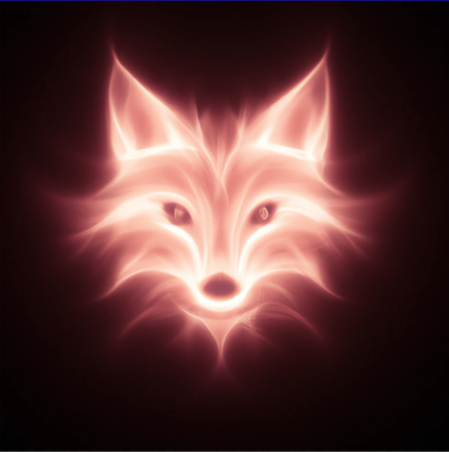

# 🦊 Fox Vulkan Path Tracing Renderer

A low-level forward path tracing renderer built from scratch using the **Vulkan API** and **C++**



## 📌 Overview

The **Fox Vulkan Path Tracing Renderer** leverages modern GPU hardware to produce photorealistic imagery. It features robust support for the glTF 2.0 standard and utilizes a physically based rendering (PBR) pipeline to accurately simulate light interaction.

* **API:** Vulkan (Modern C++ binding)
* **Shading Model:**  Physically Based Rendering (PBR) using the Cook-Torrance microfacet BRDF.
* **Format:** Industry-standard glTF 2.0 (both `.gltf` and `.glb` files).

---

## 🚀 Key Features

* **Pipeline:** Engineered from the ground up to utilize hardware-accelerated ray tracing and modern memory management.
* **glTF 2.0 Asset Loading:** Built-in parser supporting both binary (`.glb`) and text-based (`.gltf`) scenes.
* **Path Tracing** Iterative, unbiased path tracer with multiple importance sampling, Russian roulette and soft shadows.
* **Physically Based Shading** Layered glTF metallic-roughness BSDF: GGX microfacet specular (visible-normal importance sampling,
  height-correlated Smith, multiple-scattering energy compensation) over an energy-conserving diffuse layer, plus thin glass.
  Supports base colour, metallic-roughness, normal and emissive textures and `KHR_texture_transform`,
  `KHR_materials_transmission`, `KHR_materials_specular`, `KHR_materials_emissive_strength`.
* **Lighting** Importance-sampled HDR environment map, emissive quads as area lights and a sun with soft shadows.
* **Denoising** Pluggable denoisers, switchable at runtime:
  * **DLSS Ray Reconstruction** (NVIDIA, optional): neural denoising + anti-aliasing with the newest transformer model.
  * **SVGF** (Spatiotemporal Variance-Guided Filtering): temporal reprojection + variance-guided a-trous wavelet filter, in compute shaders.
  * **Accumulation**: plain averaging while the camera is still, as the ground-truth reference.
* **HDR Pipeline** Floating point rendering and an AgX tone mapping pass with exposure control.

---

## 🔧 Building

**Requirements**

* Windows, Visual Studio 2022 (v143 toolset, C++20)
* [Vulkan SDK](https://vulkan.lunarg.com/) 1.4+ installed with the **SDL2** and **GLM** components. The project locates
  everything (headers, libraries and the `slangc` shader compiler) through the `VULKAN_SDK` environment variable that the installer sets.
* A GPU with hardware ray tracing (`VK_KHR_ray_tracing_pipeline`) and mesh shader (`VK_EXT_mesh_shader`) support.

**Steps**

1. Open `FoxVulkanPathTracer.sln` and select the `x64` platform (`Debug` or `Release`).
2. Build. The Slang shaders in `FoxVulkanPathTracer/Shaders` are compiled to SPIR-V as part of the build
   (`Shaders/compile_shaders_slang.bat` does the same by hand).
3. Run from Visual Studio. Assets are loaded relative to the project directory (`FoxVulkanPathTracer/`),
   which is the default debugger working directory. `SDL2.dll` is picked up from the Vulkan SDK's `Bin` folder on `PATH`.

`Debug` builds enable the Vulkan validation layers and print warnings and errors to the console.

**Optional: DLSS Ray Reconstruction**

The DLSS denoiser is compiled in automatically when NVIDIA's DLSS SDK is found in `ThirdParty/DLSS` next to the solution:

```bash
git clone --depth 1 --branch v310.9.16 https://github.com/NVIDIA/DLSS.git ThirdParty/DLSS
```

The SDK is not part of this repository (it is listed in `.gitignore`) and is covered by NVIDIA's own license (`ThirdParty/DLSS/LICENSE.txt`).
The build copies `nvngx_dlssd.dll` next to the executable. At runtime it needs an RTX GPU and a current driver;
if DLSS is unavailable the renderer says so on the console and starts with SVGF instead.

### Adding a denoiser

Derive from `Denoiser` (`Graphics/Vulkan/Raytracing/Denoiser.h`), implement `Resize` / `Denoise` / `GetOutputView`, and register the class in
`CreateDenoisers()` (`Denoiser.cpp`). The path tracer hands every denoiser the same G-buffer (`GBuffer.h`): noisy radiance, diffuse and
specular albedo, normal, roughness, depth, motion vectors and specular hit distance. `ComputePass` wraps a full-screen compute shader.

## 🎮 Controls

| Input | Action |
| --- | --- |
| Mouse | Look around |
| `W` `A` `S` `D` | Move |
| `R` / `F` | Move up / down |
| `N` | Next denoiser (DLSS Ray Reconstruction → SVGF → Accumulation) |
| `1` / `2` | Exposure down / up (1/3 stop) |
| `3` / `4` | Fewer / more paths per pixel |
| `9` / `0` | Decrease / increase environment map intensity |
| `T` | Toggle fullscreen |
| `Esc` | Quit |

The window title shows the active denoiser, the paths per pixel and the frame rate.

---

## 🛠️ Road Map / Future Developments

Below is the active development checklist for the renderer.

### 💡 Rendering & Lighting

- [x] Multiple Importance Sampling (MIS) lighting
- [ ] Refraction and Fresnel effects
- [x] Recursive BRDF evaluation / ray depth handling
- [x] Normal mapping
- [ ] Displacement mapping
- [x] Denoiser integration (SVGF & DLSS Ray Reconstruction)

### ⛰️ Procedural & Special Effects
- [ ] Procedural terrain generation
- [ ] Procedural tree generation
- [ ] Particle systems and GPU-driven effects

### 🏗️ Scene Graph & Performance
- [ ] Acceleration structure (BLAS/TLAS) refitting
- [ ] Full hierarchical scene graph
- [ ] Instance buffer updates for dynamic object movement
- [ ] Scene configuration files using JSON (*Fox Scene format*)

### 🏃 Animation & Physics
- [ ] Skeletal animation support
- [ ] Integration of a physics engine (e.g., Box2D/3D physics library)

### 🐛 Bug Fixes & Refinement
- [ ] Improved glTF binary format compliance (roughness, metallic parameter checks)

---